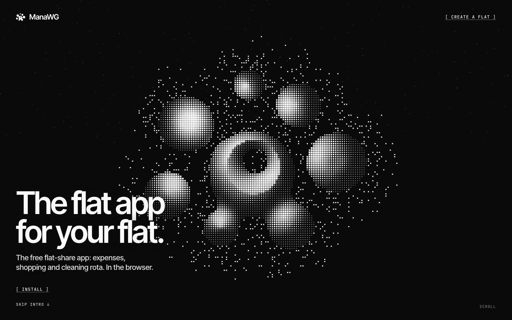
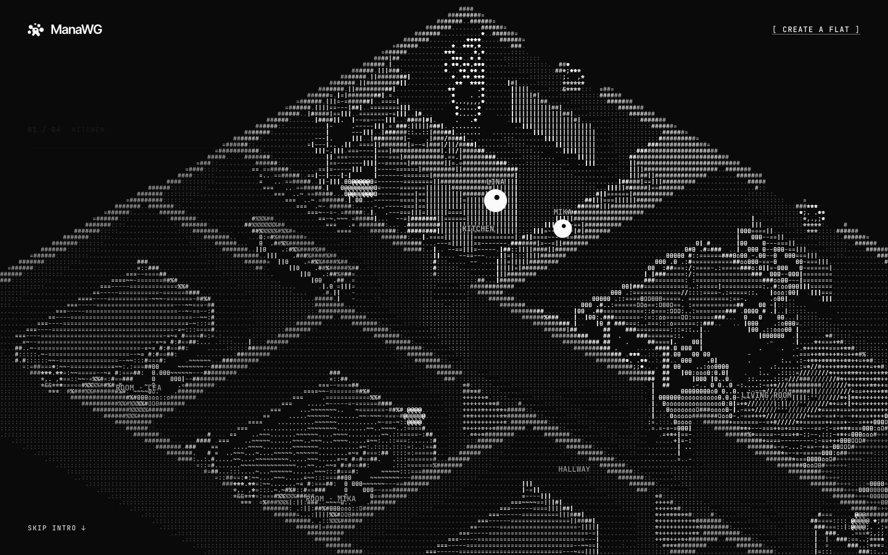
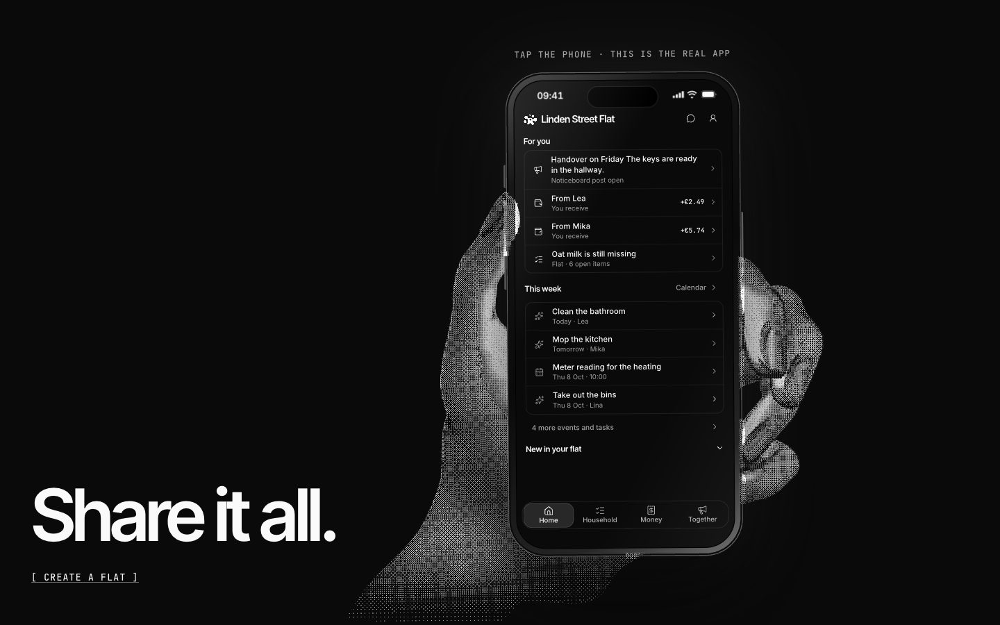

<p align="center"></p>

<h1 align="center">ManaWG website</h1>

<p align="center">
  <strong>The source of <a href="https://manawg.com">manawg.com</a>, the website of the free, open-source app for shared flats.</strong>
</p>

<p align="center">
  <a href="https://manawg.com/en"><strong>Visit the site</strong></a> ·
  <a href="https://github.com/Abuarchiv/manawg">App repository</a> ·
  <a href="#run-it-locally">Run it locally</a> ·
  <a href="CONTRIBUTING.md">Contribute</a>
</p>

<p align="center">
  <a href="https://github.com/Abuarchiv/manawg-landing/actions/workflows/ci.yml"></a>
  <a href="LICENSE"></a>
  
</p>

<p align="center">
  
  
  
</p>

The home page is one scroll-driven stage: canvas scenes drawn in halftone and ASCII, and at the end
a phone that runs the real app. Around it sit topic pages and guides for shared flats, the legal
pages, and machine-readable files, all in English and German.

The app itself lives in [Abuarchiv/manawg](https://github.com/Abuarchiv/manawg). This repository
contains only the website.

## Run it locally

You need Node.js 22 and pnpm 9.

```sh
corepack enable
pnpm install
pnpm dev          # http://localhost:3100
```

| Script | What it does |
|---|---|
| `pnpm dev` | Dev server on port 3100 |
| `pnpm lint` | Biome check |
| `pnpm typecheck` | `tsc --noEmit` |
| `pnpm test` | Unit tests (`src/**/*.test.ts`) |
| `pnpm build` | Production build |

Before opening a pull request, run `pnpm lint && pnpm typecheck && pnpm test && pnpm build`. If a
dev server is already running, build into a separate folder with
`NEXT_DIST_DIR=.next-check pnpm build` and delete it afterwards.

`NEXT_PUBLIC_APP_URL` sets the public origin used for canonical links, the sitemap and structured
data. Leave it unset for local work.

## How the home page works

- **One frame loop.** `src/components/landing/core/loop.ts` runs a single `requestAnimationFrame`
  loop for the whole page. Each scene registers when it mounts and only gets frames while it is
  visible; the loop pauses while the tab is hidden.
- **One coordinate space.** Every canvas follows its CSS box and draws into a 1280 × 800 reference
  box that is fitted into the screen (`core/canvas.ts`), so a scene looks the same on a phone and
  on a wide monitor.
- **Native scroll.** Sections are measured in `core/scroll.ts`. Mouse wheel and trackpad glide
  through [Lenis](https://lenis.darkroom.engineering), driven by the same frame clock; touch
  scrolling stays native, and with reduced motion Lenis is off.
- **Scenes** live in `scenes/`, one folder each. The phone at the end embeds a recorded run of the
  real app from `public/app-demo/`.

## Routes

| Language | Home | Topic pages | Guides | Legal pages |
|---|---|---|---|---|
| German | `/` | `/<slug>` | `/ratgeber` | `/impressum`, `/datenschutz`, `/agb` |
| English | `/en` | `/en/<slug>` | `/en/guides` | `/en/legal-notice`, `/en/privacy`, `/en/terms` |

- German lives at the site root and English under `/en`, each with its own slugs. The slug map is
  in `src/lib/locale.ts`.
- Every page that exists in both languages declares `hreflang` alternates and links to its
  counterpart.
- The English legal pages are convenience translations. The German versions are the legally
  binding ones.
- Machine-readable files: `/llms.txt` and `/en/llms.txt`, `/llms-full.txt` and
  `/en/llms-full.txt`, `/feed.xml` and `/en/feed.xml`, plus `sitemap.xml` and `robots.txt`.

## Project layout

| Path | Contents |
|---|---|
| `src/app/` | Routes, split into `(de)` and `(en)` route groups with one root layout each, plus `robots`, `sitemap` and the 404 and error pages |
| `src/components/landing/` | The home page: frame loop, canvas and scroll code in `core/`, one folder per scene in `scenes/`, header, loader and hints in `shell/` |
| `src/content/` | Home page copy per language and the app demo paths |
| `src/topics/` | Topic and guide pages: German data in `de/`, English data in `en/`, shared renderers and UI strings |
| `src/lib/` | Locale helpers and slug map, app and site URLs, security headers, shared text link style |
| `public/` | Fonts, image sequences, the embedded app demo and install screenshots, `llms.txt` files |

## Stack

[Next.js](https://nextjs.org) 15 (App Router, statically prerendered), React 19,
[Tailwind CSS](https://tailwindcss.com) 3, [Lenis](https://lenis.darkroom.engineering),
TypeScript, [Biome](https://biomejs.dev) and `node --test`. The scenes call the Canvas 2D and
WebGL APIs directly, without an animation or 3D library.

## Contributing

Fixes to wording, translations, facts and broken pages are welcome, and so is criticism: if a page
is unclear, slow or wrong, an issue about it helps. Keep German and English pages in step, and
describe only what the app really does today. The home page has a fixed design: copy fixes are
welcome, changes to layout or motion need an issue first. Details are in
[CONTRIBUTING.md](CONTRIBUTING.md); security problems go through [SECURITY.md](SECURITY.md).

Problems with the app itself belong in the
[app repository](https://github.com/Abuarchiv/manawg/issues/new/choose).

## License

The website is open source under the [Apache License 2.0](LICENSE), like
[the app](https://github.com/Abuarchiv/manawg). The fonts keep their own licences, see
[THIRD-PARTY-NOTICES.md](THIRD-PARTY-NOTICES.md). The licence does not grant rights to the name
ManaWG or its logo; forks that publish a site of their own use their own name and logo.
